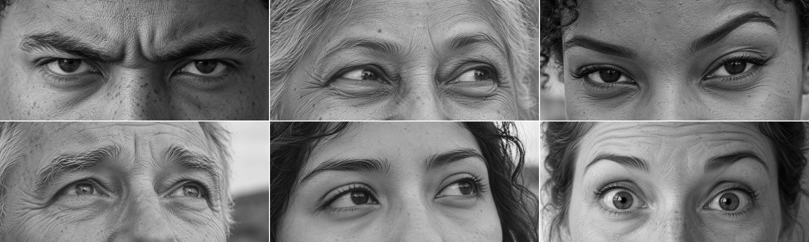
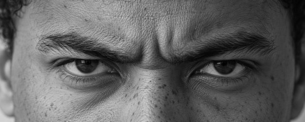
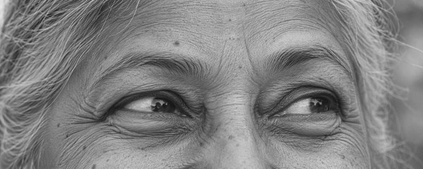
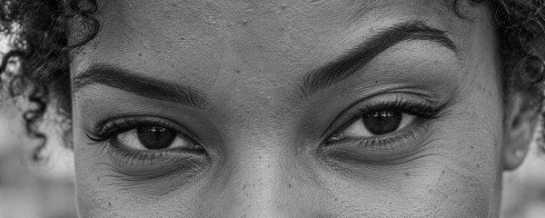
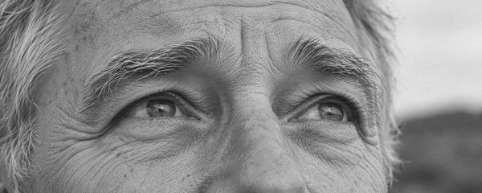
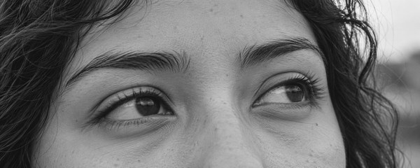
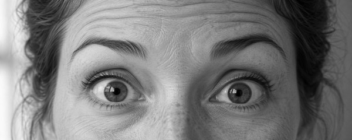

# Reading the Eyes

Reading the Eyes is a test of how well you read facial expressions when only the eyes are showing.

**[Take the test at neuropsych.io](https://neuropsych.io/tests/reading-the-eyes/)** &nbsp;&middot;&nbsp; **[Hazlo en español](https://neuropsych.io/es/tests/reading-the-eyes/)**

<table>
  <tr>
    <td></td>
    <td></td>
    <td></td>
  </tr>
  <tr>
    <td></td>
    <td></td>
    <td></td>
  </tr>
</table>

There are forty photographs, each with four words beside it and one right answer. Twenty of them make up the test, in English or Spanish, and it takes about four minutes.

Every photograph is an AI image, made from a written description of a person and the feeling in their eyes. [Read the full method](https://neuropsych.io/reading-the-eyes/method/).

## Licences and credit

Everything in `images/` and `assets/` is CC0 1.0. `items.json`, `items.csv` and `prompts.md` are CC BY 4.0, with credit to Neuropsych.

Cite as: Neuropsych (2026). Reading the Eyes, version 1.0.0. https://github.com/cristiandominguezrl/reading-the-eyes

The format comes from the Reading the Mind in the Eyes Test by [Baron-Cohen, Wheelwright, Hill, Raste and Plumb (2001)](https://doi.org/10.1111/1469-7610.00715).

## Files

| Path | What it holds |
|------|---------------|
| `items.json` | The four words for every photograph, one practice photograph included, with their meanings in English and Spanish, and a short note on the person and the expression. |
| `items.csv` | The same words as a table, one row per photograph, without the practice photograph. |
| `prompts.md` | The full text every photograph was made from. |
| `images/1200x480/` | The photographs as shown on neuropsych.io (1200 by 480, black and white). |
| `images/full/` | The same photographs at full size (1983 by 793). |
| `assets/` | Banner and gallery images for this page. |
| `LICENSE-IMAGES.md`, `LICENSE-DATA.md` | The two licences. |
| `CHANGELOG.md` | Release history. |
